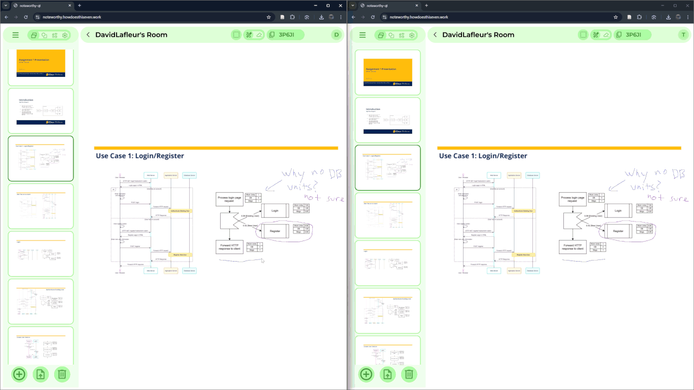
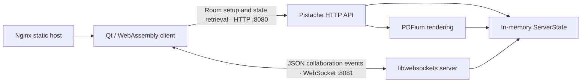

# Noteworthy

Noteworthy is a collaborative canvas and note-taking application written in C++.
The client uses Qt for its interface and graphics scene, compiles to WebAssembly
for the browser, and exchanges JSON events with a C++ server over HTTP and
WebSockets.



The recording shows the original two-user demo. It is included here so the app
can be seen without a running server. The former live demo is currently offline.

## Project background and my contribution

Noteworthy was built as an ELEC376 group project at Queen's University in
September–December 2024. This repository combines the client and server in an
imported snapshot. Its first commit records that import; the original development
history is not included here.

I implemented the drawing tools and contributed to room state, WebSocket
collaboration, HTTP endpoints, and PDF import. The interface and remaining
features were developed with the project team.

The [original client repository](https://github.com/davlaf/noteworthy-qt) and
[original server repository](https://github.com/davlaf/noteworthy-server) were
published by teammate David. The demo recording above comes from the client
repository. The team's [project presentation](server/ELEC376%20Group%209%20-%20Noteworthy.pdf)
documents the features, technologies, and development retrospective.

## What it supports

- shared rooms identified by short room codes;
- optional room passwords and basic room-owner controls;
- multiple ordered pages;
- freehand drawing and erasing;
- bounding-box selection and object movement;
- shapes and electrical symbols; and
- PDF upload, rendering, and insertion as canvas pages.

## Architecture



The HTTP API creates rooms and users, returns a room as an ordered list of JSON
events, and accepts PDF uploads. After loading that initial state, the client
opens a WebSocket connection. Drawing, page, user, and room operations are
serialized as JSON events; the server applies each event to its copy of the room
state and forwards it to the other connected clients.

The client applies its own events locally as it sends them. That keeps drawing
responsive while the server remains the shared relay and room-state holder.

## Repository layout

- `qt/` — Qt client, graphics-scene interaction, client-side room state, and
  WebAssembly/Nginx packaging.
- `server/src/` — HTTP API, WebSocket handling, shared room state, and PDF
  rendering.
- `server/test/` — Python integration tests for room, user, password, page, and
  WebSocket behaviour.
- `server/compose.yaml` — local server container and optional hosted-demo
  services.

## Running the server

The existing setup scripts were written and tested for Ubuntu under WSL.

```bash
cd server
./scripts/setup_build.sh
./scripts/compile_locally.sh
./scripts/run_server.sh
```

The server starts an HTTP API on port `8080` and a WebSocket endpoint on port
`8081`.

To build and run the server container instead:

```bash
cd server
docker compose up --build
```

## Running the integration tests

Start the server locally, then run:

```bash
python3 -m venv .venv
source .venv/bin/activate
pip install -r server/test/requirements.txt
python server/test/websocket-client-test.py
```

The tests target `http://localhost:8080` and `ws://localhost:8081` by default.

## Client build

The Compose client image builds Qt 6.8.3 single-threaded WebAssembly and serves
it through nginx. Run the client and server locally from the repository root.

```bash
NW_HTTP_URL=http://localhost:8084 NW_WS_URL=ws://localhost:8081 \
  docker compose -f server/compose.yaml --profile local up -d --build
```

Open `http://localhost:8084`.

## Current constraints

- Room, page, user, and canvas state live in the server process. Restarting the
  server loses active rooms; durable persistence and recovery are not
  implemented.
- Hosted and local endpoints are set at build time with `NW_HTTP_URL` and
  `NW_WS_URL`.
- The project is a working prototype and still contains incomplete paths,
  including text objects and some canvas transforms.

These constraints are part of the current source, not claims about the intended
final architecture.
