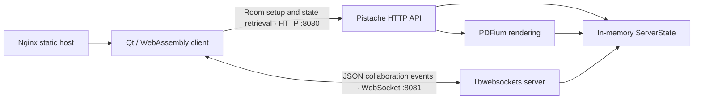

# Noteworthy

Noteworthy is a collaborative canvas and note-taking application written in C++.
The client uses Qt for its interface and graphics scene, compiles to WebAssembly
for the browser, and exchanges JSON events with a C++ server over HTTP and
WebSockets.

[Open the live demo](https://noteworthy.howdoesthiseven.work/)

## What it supports

- shared rooms identified by short room codes;
- optional room passwords and basic room-owner controls;
- multiple ordered pages;
- freehand drawing and erasing;
- bounding-box selection and object movement;
- shapes and electrical symbols; and
- PDF upload, rendering, and insertion as canvas pages.

## Architecture



The HTTP API creates rooms and users, returns a room as an ordered list of JSON
events, and accepts PDF uploads. After loading that initial state, the client
opens a WebSocket connection. Drawing, page, user, and room operations are
serialized as JSON events; the server applies each event to its copy of the room
state and forwards it to the other connected clients.

The client applies its own events locally as it sends them. That keeps drawing
responsive while the server remains the shared relay and room-state holder.

## Repository layout

- `qt/` — Qt client, graphics-scene interaction, client-side room state, and
  WebAssembly/Nginx packaging.
- `server/src/` — HTTP API, WebSocket handling, shared room state, and PDF
  rendering.
- `server/test/` — Python integration tests for room, user, password, page, and
  WebSocket behaviour.
- `server/compose.yaml` — local server container and optional hosted-demo
  services.

## Running the server

The existing setup scripts were written and tested for Ubuntu under WSL.

```bash
cd server
./scripts/setup_build.sh
./scripts/compile_locally.sh
./scripts/run_server.sh
```

The server starts an HTTP API on port `8080` and a WebSocket endpoint on port
`8081`.

To build and run the server container instead:

```bash
cd server
docker compose up --build
```

## Running the integration tests

Start the server locally, then run:

```bash
python3 -m venv .venv
source .venv/bin/activate
pip install -r server/test/requirements.txt
python server/test/websocket-client-test.py
```

The tests target `http://localhost:8080` and `ws://localhost:8081` by default.

## Client build status

The Qt target depends on Qt 6 Widgets, WebSockets, SVG, and SVG Widgets. The
checked-in client container expects artifacts from a Qt 6.8 single-threaded
WebAssembly build and serves them with the correct `application/wasm` MIME type.

**TODO:** Document and automate a clean Qt WebAssembly build from a fresh
checkout. The repository currently contains the CMake target and deployment
container, but not a complete reproducible client-build command.

## Current constraints

- Room, page, user, and canvas state live in the server process. Restarting the
  server loses active rooms; durable persistence and recovery are not
  implemented.
- Hosted and local API endpoints are selected at compile time in `qt/hosts.hpp`.
- The project is a working prototype and still contains incomplete paths,
  including text objects and some canvas transforms.

These constraints are part of the current source, not claims about the intended
final architecture.
